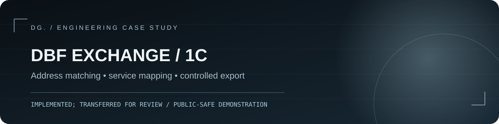
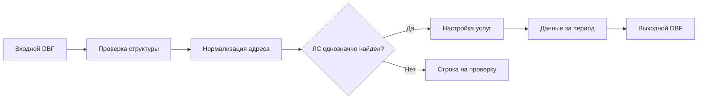

# Обмен DBF с внешней системой / 1С:Предприятие

**Тип:** профессиональный кейс по внешней обработке 1С · **Статус:** реализовано, передано на внутреннюю проверку (отдельную окончательную приёмку не заявляю) · **Моя роль:** разработка и отладка механизма обмена.

> Это публичное описание реальной инженерной задачи и **отдельная демонстрационная реализация** алгоритмов на Python (stdlib). Производственная `.epf`, исходный BSL-модуль, данные заказчика и реальная спецификация обмена не опубликованы.

## Задача

Из поступающего DBF-пакета нужно сформировать ответный пакет: связать запись с лицевым счётом по адресу (не полагаться на номер договора), сопоставить услуги с категориями обмена, получить начисления и задолженность из информационной базы и сохранить структуру файла. В разных базах одной конфигурации состав и названия услуг различаются.

## Что реализовывалось

- Чтение/запись DBF через механизм XBase 1С с сохранением структуры исходного файла.
- Поиск ЛС по сочетанию «улица / дом / корпус / квартира»; отдельная обработка объектов **без квартиры**, отказ от произвольного выбора при неоднозначном совпадении.
- Сопоставление услуг: автоматические правила + пользовательские соответствия + категория «Не выгружать», с возможностью изменить решение позже.
- Заполнение финансовых полей из регистров за выбранный расчётный период, сообщения об ошибках сопоставления.
- Переработка выбора файла под управляемые формы и сценарии тонкого/толстого клиента; web-клиент в конкретной среде не подтверждён.

## Схема



## Проверяемый публичный код

В [`demo/`](demo/) находится **самостоятельная модель** адресного поиска и выбора правил, а не копия корпоративной логики. Здесь входные записи заданы объектами Python, чтобы демонстрация запускалась без 1С и реальных DBF.

```bash
python -m unittest discover -s tests -v
python -m demo.cli
```

В тестах показаны обычные адреса, дом без квартиры, отсутствие совпадений и неоднозначные совпадения (такие случаи не разрешаются догадкой). Отдельно тестируется приоритет ручных правил услуг.

## Инженерные решения

| Риск | Принятый подход |
|---|---|
| Договоры в системах различаются | Основа поиска — нормализованный адрес |
| Дом без квартиры | Ищем только самостоятельный объект без квартиры; не выбираем случайную квартиру |
| Похожие адреса дают несколько ЛС | Явная неоднозначность и ручная проверка данных |
| У клиентов разный набор услуг | Автоподбор дополняется настройками, а не жёсткой привязкой к ссылкам конкретной базы |
| Ошибка на стороне клиента при выборе файла | Асинхронный клиентский сценарий и серверная обработка отдельно |

**Границы публикации:** без реальных записей, регистров, идентификаторов организаций, закрытой спецификации, файлов Z/O и исходного коммерческого кода. [Контрольный список](PUBLICATION_CHECKLIST.md).

## Требования и структура

Нужен Python 3.10 или новее. Внешние пакеты не требуются: используется только стандартная библиотека. Команды запускайте из корня репозитория. Автопроверки GitHub Actions настроены на Python 3.12.

```text
README.md       — задача, вклад, статус и запуск
demo/           — независимая демонстрация
docs/           — архитектура и ограничения
assets/         — обложка кейса
tests/          — модульные тесты демо
.github/        — автоматические проверки
```

## Права на материалы

Лицензия на свободное использование не предоставлена. Условия повторного использования кода и материалов необходимо согласовать с правообладателем. Публикация кейса не предоставляет прав на продукты 1С, 1С-Битрикс или материалы третьих лиц.
